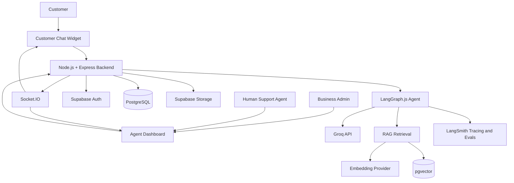
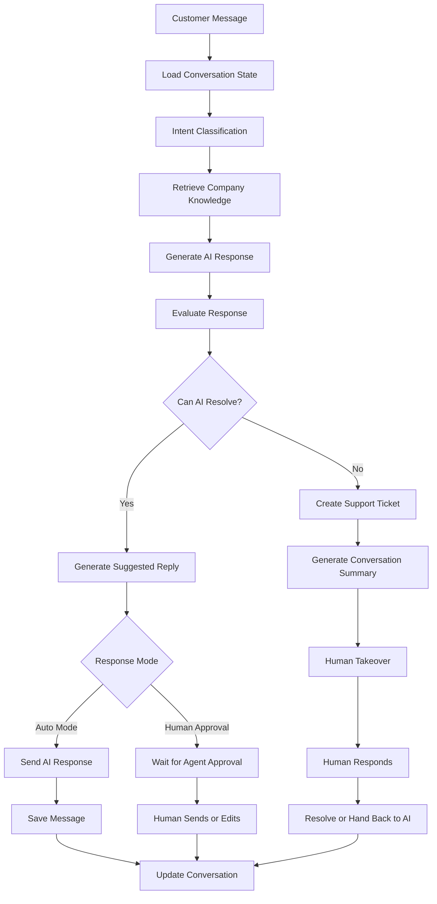
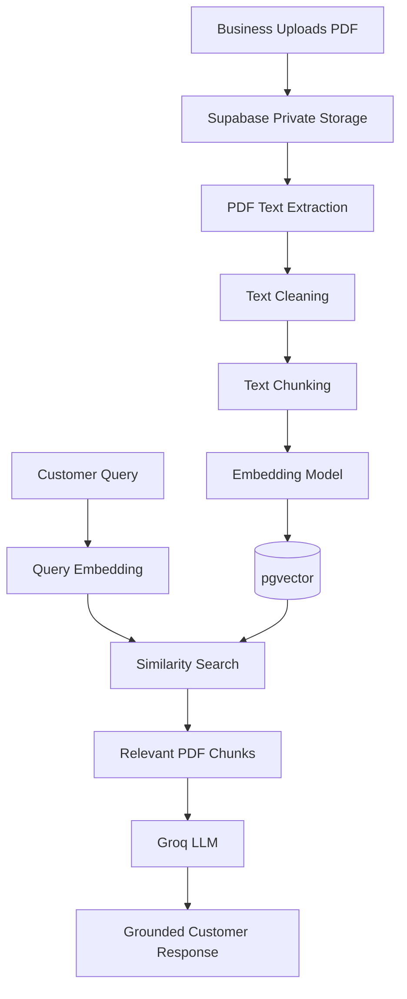
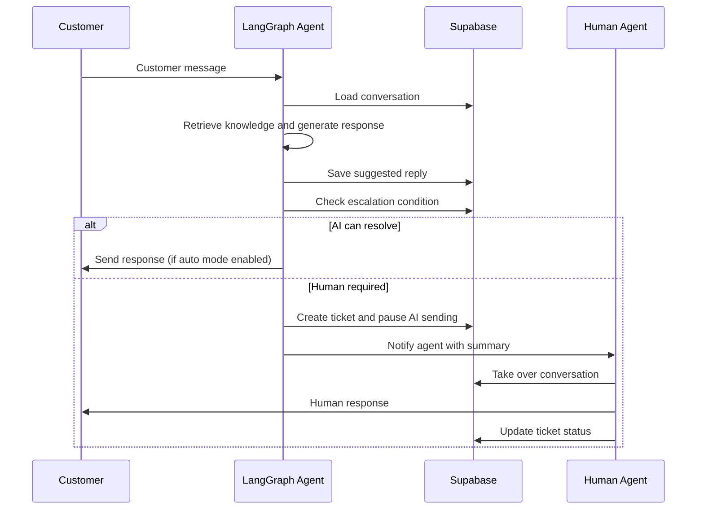
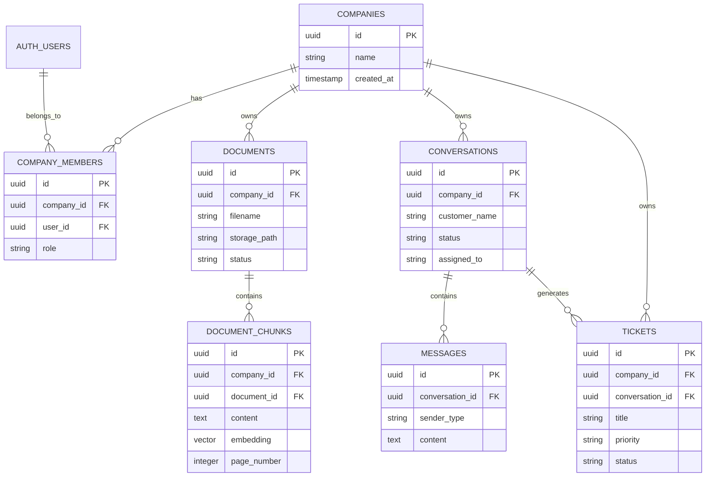

# SERVIQ-X
### The Next Generation of Intelligent Customer Support

```text
███████╗███████╗██████╗ ██╗   ██╗██╗ ██████╗       ██╗  ██╗
██╔════╝██╔════╝██╔══██╗██║   ██║██║██╔═══██╗      ╚██╗██╔╝
███████╗█████╗  ██████╔╝██║   ██║██║██║   ██║       ╚███╔╝
╚════██║██╔══╝  ██╔══██╗╚██╗ ██╔╝██║██║   ██║       ██╔██╗
███████║███████╗██║  ██║ ╚████╔╝ ██║╚██████╔╝      ██╔╝ ██╗
╚══════╝╚══════╝╚═╝  ╚═╝  ╚═══╝  ╚═╝ ╚═════╝       ╚═╝  ╚═╝

        [ S M A R T   S U P P O R T   S Y S T E M ]
        [ AI AUTOMATION + HUMAN INTELLIGENCE     ]

01010011 01000101 01010010 01010110 01001001 01010001
```

> **Every query understood. Every issue moving towards resolution.**

SERVIQ-X is an AI-powered customer support platform that automates customer conversations using company-specific knowledge bases while keeping human support agents in control.

It combines AI-powered response generation, document-based knowledge retrieval, intelligent ticket management, human takeover, and AI observability in one unified support workspace.

---

## Table of Contents

1. Project Overview
2. Problem Statement
3. Our Solution
4. Core Features
5. Technology Stack
6. System Architecture
7. AI Agent Architecture
8. PDF Knowledge Base and RAG
9. Human-in-the-Loop Workflow
10. Database Architecture
11. Authentication and Security
12. AI Observability and Evaluations
13. Project Structure
14. Environment Variables
15. Installation and Setup
16. API Overview
17. Development Roadmap
18. Team Responsibilities

---

## 1. Project Overview

SERVIQ-X is designed for businesses that want to provide fast, reliable, and intelligent customer support without completely replacing human support teams.

Businesses can create an account, upload their company policies and documentation, configure an AI support agent, and integrate a customer-facing chat interface.

The AI agent uses the company's knowledge base to answer customer queries. When an issue requires human attention, the system creates or updates a support ticket and transfers control to a human agent.

The human agent can inspect the conversation, review AI-generated suggested replies, and take over the conversation in real time.

### Our Core Philosophy

```text
             CUSTOMER
                 |
                 v
          +--------------+
          |  SERVIQ-X AI |
          +--------------+
                 |
          +------+------+
          |             |
          v             v
    AI CAN SOLVE?   NEEDS HUMAN?
          |             |
          v             v
     AI RESPONSE    CREATE TICKET
          |             |
          v             v
    CUSTOMER       HUMAN AGENT
      ANSWER        TAKEOVER
          |             |
          +------+------+
                 |
                 v
           RESOLUTION
```

---

## 2. Problem Statement

Traditional customer support systems face several challenges:

- High volumes of repetitive customer queries.
- Slow response times.
- Increased operational costs.
- Inconsistent responses from support representatives.
- Difficulty searching through large company documentation.
- Lack of context when conversations are transferred between AI and humans.
- Limited visibility into how AI-generated responses are produced.
- Difficulty evaluating the accuracy and reliability of AI agents.

Businesses need a system that combines automation with human judgment.

---

## 3. Our Solution

SERVIQ-X provides an intelligent support platform with:

1. AI-powered customer conversations.
2. Company-specific PDF knowledge bases.
3. Retrieval-Augmented Generation (RAG).
4. Intelligent ticket creation and prioritization.
5. AI-generated suggested replies.
6. Real-time human takeover and handback.
7. Conversation summaries and context preservation.
8. AI tracing, monitoring, and evaluation.
9. Multi-company data isolation.

Our goal is not simply to generate answers. It is to help resolve customer issues through controlled AI automation and human collaboration.

---

## 4. Core Features

### 4.1 AI Customer Support

- Conversational AI assistant.
- Context-aware responses.
- Multi-turn conversation history.
- Company-specific knowledge retrieval.
- Intent classification.
- Escalation when the AI cannot confidently resolve an issue.

### 4.2 Company Knowledge Base

Businesses can upload their own PDF files, such as:

- Refund policies.
- Shipping policies.
- Product documentation.
- Payment policies.
- Frequently asked questions.
- Company guidelines.

The backend extracts text, divides it into chunks, generates embeddings, and stores them for semantic retrieval.

### 4.3 Intelligent Ticket Management

- Automatic ticket creation for escalated queries.
- Priority classification.
- Ticket categories.
- Open, in-progress, and resolved states.
- Conversation-to-ticket association.

### 4.4 Agent Console

The business dashboard includes:

- Live conversations.
- Customer conversation history.
- AI-generated suggested replies.
- Editable replies before sending.
- Regenerate and reject suggestion actions.
- AI-generated conversation summaries.
- Human takeover.
- Return control to AI.
- Ticket information and escalation reason.
- Knowledge source references.

### 4.5 Human-in-the-Loop

Human agents can take control of conversations whenever necessary.

When takeover occurs:

- Conversation ownership changes to human.
- AI automatic replies are paused.
- The human agent receives the conversation context.
- The AI can continue generating suggestions for the agent.
- The human agent can resolve the ticket or hand control back to AI.

### 4.6 AI Observability and Evaluations

Using LangSmith:

- Agent execution traces.
- LLM request and response monitoring.
- Latency tracking.
- Token usage tracking.
- Retrieval evaluation.
- Answer correctness evaluation.
- Groundedness evaluation.
- Escalation accuracy evaluation.
- Human feedback and test datasets.

---

## 5. Technology Stack

| Layer | Technology |
|---|---|
| Frontend | React.js |
| Language | TypeScript |
| Build Tool | Vite |
| Styling | Tailwind CSS |
| Icons | Lucide React |
| Backend | Node.js |
| API Framework | Express.js |
| Agent Orchestration | LangGraph.js |
| Primary LLM Provider | Groq API |
| LLM API Key | GROQ_API_KEY |
| AI Observability | LangSmith |
| Database | PostgreSQL |
| Database Hosting | Supabase |
| Vector Search | pgvector |
| Authentication | Supabase Auth |
| PDF Storage | Supabase Storage |
| PDF Processing | PDF parsing library |
| Embeddings | Configurable embedding provider |
| Real-time Updates | Socket.IO |
| Version Control | Git + GitHub |

### AI Provider Configuration

Groq is the primary LLM inference provider.

The application uses the Groq API for:

- AI-generated customer responses.
- Intent detection.
- Conversation summaries.
- Ticket classification.
- Suggested replies.
- Agent reasoning and tool selection.

The Groq API key must remain on the backend.

**Important:** PDF embeddings are generated separately from Groq chat completions. Use a compatible embedding model, such as a Google Gemini embedding model or a local embedding model. Store the model name and vector dimensions consistently.

---

## 6. System Architecture

### High-Level Architecture



### Component Responsibilities

**Frontend**
- Business dashboard.
- Authentication screens.
- Conversation management.
- Customer chat widget.
- Ticket management.
- Knowledge base management.

**Backend**
- API endpoints.
- Authentication verification.
- Tenant authorization.
- PDF processing.
- Agent invocation.
- Database operations.
- Real-time communication.

**Supabase**
- PostgreSQL database.
- Authentication.
- Private PDF storage.
- pgvector similarity search.
- Row Level Security.

**LangGraph**
- Agent workflow.
- Intent classification.
- Retrieval orchestration.
- Response generation.
- Escalation decisions.
- Human-in-the-loop state management.

**Groq**
- Fast LLM inference.
- Response generation.
- Structured outputs and tool calling.
- Intent classification and summarization.

**LangSmith**
- Tracing.
- Monitoring.
- Offline evaluations.
- Online evaluations where configured.
- Human feedback.

---

## 7. AI Agent Architecture

SERVIQ-X uses LangGraph.js to implement a controlled AI support workflow.

### Agent Workflow



### LangGraph Responsibilities

The initial graph will contain the following nodes:

1. `loadConversation`
2. `classifyIntent`
3. `retrieveKnowledge`
4. `generateResponse`
5. `evaluateResponse`
6. `createTicket`
7. `generateSummary`
8. `humanApproval`
9. `sendResponse`
10. `updateConversation`

The graph uses persistent conversation state and a stable conversation thread identifier.

Human takeover must also be enforced in the backend and database, not only through a LangGraph interrupt.

---

## 8. PDF Knowledge Base and RAG

SERVIQ-X uses Retrieval-Augmented Generation to produce company-specific answers.

### PDF Processing Pipeline



### Processing Steps

1. Business uploads a PDF.
2. File is stored in a private Supabase Storage bucket.
3. Backend extracts text.
4. Extracted text is divided into smaller chunks.
5. Embedding model converts chunks into vectors.
6. Vectors and metadata are stored in PostgreSQL using pgvector.
7. Customer asks a question.
8. The question is converted into an embedding.
9. Similarity search retrieves relevant company-specific chunks.
10. Retrieved context is passed to Groq.
11. Groq generates a grounded answer.
12. The answer can include document names and page references.

### Document Metadata

Each chunk should contain:

- `company_id`
- `document_id`
- `content`
- `embedding`
- `page_number`
- `created_at`

### Important Security Requirement

Every vector search must filter by the authenticated company's `company_id`.

One business must never retrieve another business's documents.

PDF contents must be treated as untrusted input and must never override the system instructions.

---

## 9. Human-in-the-Loop Workflow

Human takeover is one of the most important differentiators of SERVIQ-X.

### Takeover Sequence



### Ownership States

- `ai`
- `human`

### Conversation Statuses

- `open`
- `pending`
- `resolved`

AI automatic sending must be blocked whenever the conversation is owned by a human.

Suggested replies can still be generated for human approval during takeover.

---

## 10. Database Architecture

SERVIQ-X uses Supabase-hosted PostgreSQL with pgvector.

### Database Tables

| Table | Purpose |
|---|---|
| `companies` | Business account information |
| `company_members` | User-to-company membership |
| `documents` | Uploaded PDF metadata |
| `document_chunks` | Extracted text and embeddings |
| `conversations` | Customer conversations |
| `messages` | Conversation messages |
| `tickets` | Support tickets |

### Entity Relationship Diagram



### Multi-Tenant Database Design

SERVIQ-X is designed as a multi-tenant application.

Every business has its own isolated workspace.

Tenant isolation is enforced through:

- Company membership verification.
- Row Level Security policies.
- Backend authorization.
- Company-filtered document retrieval.
- Private storage access.
- Secure database operations.

---

## 11. Authentication and Security

### Authentication

Supabase Auth provides:

- Email and password signup.
- Login and logout.
- Session management.
- Access token verification.
- Password recovery.

### Security Principles

1. Never expose Supabase secret keys in the frontend.
2. Never expose the Groq API key in the frontend.
3. Keep LangSmith credentials on the backend.
4. Enable RLS on application tables.
5. Verify company membership on backend operations.
6. Keep PDF storage private.
7. Validate uploaded file type and size.
8. Validate customer and agent inputs.
9. Prevent AI from sending messages after human takeover.
10. Treat uploaded documents as untrusted data.

---

## 12. AI Observability and Evaluations

LangSmith will be used to monitor and evaluate the AI support agent.

### Evaluation Categories

| Evaluation | What it checks |
|---|---|
| Answer Correctness | Is the response factually correct? |
| Faithfulness | Is the response grounded in retrieved documents? |
| Retrieval Quality | Were relevant PDF chunks retrieved? |
| Intent Classification | Was the customer intent identified correctly? |
| Escalation Accuracy | Was human escalation appropriate? |
| Tool Execution | Were tickets and other actions executed correctly? |

### Monitoring Metrics

- LLM latency.
- Token usage.
- API errors.
- Retrieval relevance.
- Response groundedness.
- Escalation rate.
- Ticket creation success.
- Conversation resolution rate.

### Evaluation Approach

Use a combination of:

- Deterministic code-based checks.
- LLM-as-judge evaluation.
- Human feedback.
- Curated evaluation datasets.

LangSmith is an observability and evaluation layer. It does not replace the application's backend or database.

---

## 13. Project Structure

Proposed monorepo architecture:

```text
SERVIQ-X/
|
|-- frontend/
|   |-- public/
|   |-- src/
|       |-- components/
|       |-- pages/
|       |-- layouts/
|       |-- hooks/
|       |-- contexts/
|       |-- services/
|       |-- lib/
|       |-- types/
|       |-- App.tsx
|       |-- main.tsx
|   |-- package.json
|
|-- backend/
|   |-- src/
|       |-- config/
|       |-- routes/
|       |-- controllers/
|       |-- middleware/
|       |-- services/
|       |-- agents/
|       |   |-- graph.ts
|       |   |-- nodes/
|       |   |-- state.ts
|       |   |-- tools/
|       |-- rag/
|       |   |-- pdfParser.ts
|       |   |-- chunker.ts
|       |   |-- embeddings.ts
|       |   |-- retriever.ts
|       |-- database/
|       |-- sockets/
|       |-- utils/
|       |-- server.ts
|   |-- package.json
|
|-- supabase/
|   |-- migrations/
|   |-- seed.sql
|
|-- docs/
|   |-- architecture.md
|   |-- api.md
|
|-- .gitignore
|-- README.md
|-- package.json
```

This is the proposed structure; actual directories may evolve during implementation.

---

## 14. Environment Variables

Create separate environment files for the frontend and backend.

### Frontend `.env`

```env
VITE_SUPABASE_URL=your_supabase_project_url
VITE_SUPABASE_PUBLISHABLE_KEY=your_supabase_publishable_key
VITE_API_BASE_URL=http://localhost:5000/api
```

### Backend `.env`

```env
PORT=5000
NODE_ENV=development

SUPABASE_URL=your_supabase_project_url
SUPABASE_SECRET_KEY=your_supabase_secret_key

GROQ_API_KEY=your_groq_api_key
GROQ_MODEL=your_available_groq_model_id

LANGSMITH_API_KEY=your_langsmith_api_key
LANGSMITH_TRACING=true
LANGSMITH_PROJECT=SERVIQ-X

# Configure only if using a cloud embedding provider
EMBEDDING_PROVIDER=your_embedding_provider
EMBEDDING_API_KEY=your_embedding_api_key
EMBEDDING_MODEL=your_embedding_model
EMBEDDING_DIMENSIONS=your_embedding_dimensions

FRONTEND_URL=http://localhost:5173
```

Never commit real `.env` files to GitHub.

Add these to `.gitignore`:

```gitignore
node_modules/
dist/
build/
.env
.env.*
!.env.example
*.log
.DS_Store
```

### Groq API Setup

1. Visit https://console.groq.com/
2. Create an account.
3. Generate an API key.
4. Add it to the backend `.env` as `GROQ_API_KEY`.
5. Select an available Groq model and configure `GROQ_MODEL`.
6. Never expose this key in frontend code.

Official documentation: https://console.groq.com/docs/quickstart

---

## 15. Installation and Setup

### Prerequisites

- Node.js and npm.
- Git.
- Supabase account.
- Groq API account and API key.
- LangSmith account and API key.
- Embedding provider or local embedding model.

### Clone Repository

```bash
git clone https://github.com/ManasSahu-001/SERVIQ-X.git

cd SERVIQ-X
```

### Frontend Setup

```bash
cd frontend

npm install

npm run dev
```

### Backend Setup

```bash
cd backend

npm install

npm run dev
```

Configure environment variables before starting the application.

### Supabase Setup

1. Create a Supabase project.
2. Enable email/password authentication.
3. Configure redirect URLs.
4. Enable pgvector.
5. Create the private `company-documents` bucket.
6. Execute database migrations.
7. Configure RLS policies.
8. Verify company-level isolation.

---

## 16. API Overview

Proposed API endpoints:

### Authentication and Company

| Method | Endpoint | Purpose |
|---|---|---|
| POST | `/api/companies` | Create company workspace |
| GET | `/api/companies/me` | Get current company |

Authentication itself is handled through Supabase Auth.

### Knowledge Base

| Method | Endpoint | Purpose |
|---|---|---|
| POST | `/api/documents/upload` | Upload PDF |
| GET | `/api/documents` | List documents |
| GET | `/api/documents/:id` | Document details |
| DELETE | `/api/documents/:id` | Delete document |

### Conversations

| Method | Endpoint | Purpose |
|---|---|---|
| POST | `/api/conversations` | Create conversation |
| GET | `/api/conversations` | List conversations |
| GET | `/api/conversations/:id` | Get conversation |
| POST | `/api/conversations/:id/messages` | Send message |
| POST | `/api/conversations/:id/takeover` | Human takeover |
| POST | `/api/conversations/:id/handback` | Return control to AI |

### Tickets

| Method | Endpoint | Purpose |
|---|---|---|
| GET | `/api/tickets` | List tickets |
| GET | `/api/tickets/:id` | Ticket details |
| PATCH | `/api/tickets/:id` | Update ticket |

These are planned API contracts; implementation and request validation will be added during development.

---

## 17. Development Roadmap

### Phase 1 — Foundation

- Supabase project setup.
- Authentication.
- Database schema.
- Company creation.
- Multi-tenant security.

### Phase 2 — Frontend

- Landing page.
- Login and signup.
- Business dashboard.
- Agent console.
- Customer chat widget.

### Phase 3 — AI Integration

- Groq API integration.
- LangGraph agent.
- PDF extraction.
- Embedding generation.
- pgvector retrieval.
- Grounded answer generation.

### Phase 4 — Human Support

- Ticket creation.
- Suggested replies.
- Conversation summaries.
- Live takeover.
- AI handback.

### Phase 5 — Observability

- LangSmith tracing.
- Evaluation dataset.
- Groundedness checks.
- Intent evaluation.
- Escalation evaluation.

### Phase 6 — Testing and Deployment

- End-to-end testing.
- Multi-tenant security tests.
- API testing.
- Frontend deployment.
- Backend deployment.
- Final hackathon demonstration.

---

## 18. Team Responsibilities

The project is developed by a three-member team.

| Member | Responsibility |
|---|---|
| Member 1 | Frontend development and UI/UX |
| Member 2 | Backend, AI agent, RAG and integrations |
| Member 3 | Product design, QA, testing and demo preparation |

### Collaboration

- GitHub for version control.
- Feature branches for parallel development.
- Shared API contracts.
- Environment variables kept private.
- Regular integration and testing.

---

## 19. Expected Demonstration

The final demonstration will showcase the following workflow:

1. A business creates a SERVIQ-X account.
2. The business uploads its refund and shipping policy PDFs.
3. The AI knowledge base processes the documents.
4. A customer opens the chat widget.
5. The customer asks a question about an order or payment.
6. The AI retrieves relevant company policies.
7. Groq generates a contextual answer.
8. LangSmith records the agent execution trace.
9. If escalation is necessary, a ticket is created.
10. A human agent takes over the conversation.
11. The human reviews the AI-generated summary and suggested reply.
12. The agent resolves the issue.

### Example Customer Query

"I paid ₹1,299 for my order, but the order confirmation hasn't arrived."

SERVIQ-X should:

- Understand the payment-related intent.
- Retrieve the relevant payment policy.
- Provide a grounded response if the policy supports one.
- Request additional information when necessary.
- Escalate unresolved cases.
- Preserve the full conversation context for human agents.

---

## 20. Project Vision

SERVIQ-X aims to move customer support beyond simple chatbots.

It combines autonomous AI assistance, company-specific knowledge, transparent AI execution, and human collaboration into a single support ecosystem.

```text
01010011 01000101 01010010 01010110 01001001 01010001
01011000

[ AI ] + [ KNOWLEDGE ] + [ HUMAN CONTROL ]
                  |
                  v
          INTELLIGENT SUPPORT
```

**SERVIQ-X — Support, Evolved.**

---

### Project Links

- GitHub: https://github.com/ManasSahu-001/SERVIQ-X
- Groq API: https://console.groq.com/
- Supabase: https://supabase.com/
- LangGraph: https://docs.langchain.com/oss/javascript/langgraph/overview
- LangSmith: https://docs.langchain.com/langsmith/home

---

*Note: SERVIQ-X is under active development. Features and integrations described in this README represent the planned architecture and intended functionality; they should not be considered implemented until verified in the repository.*